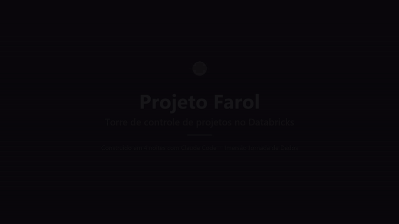
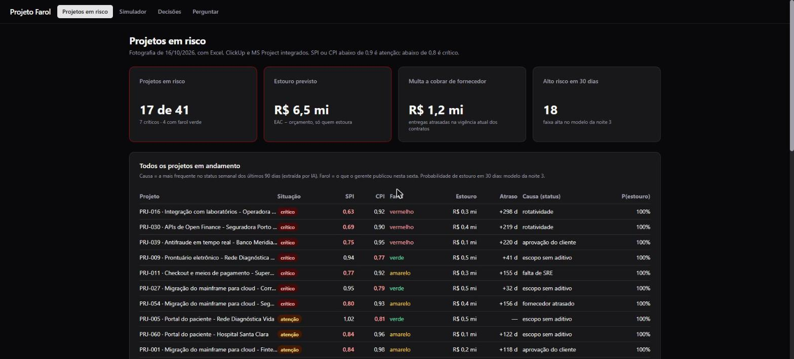
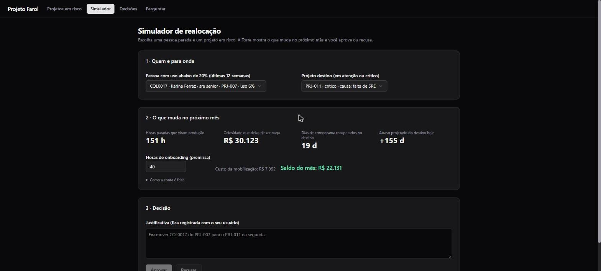
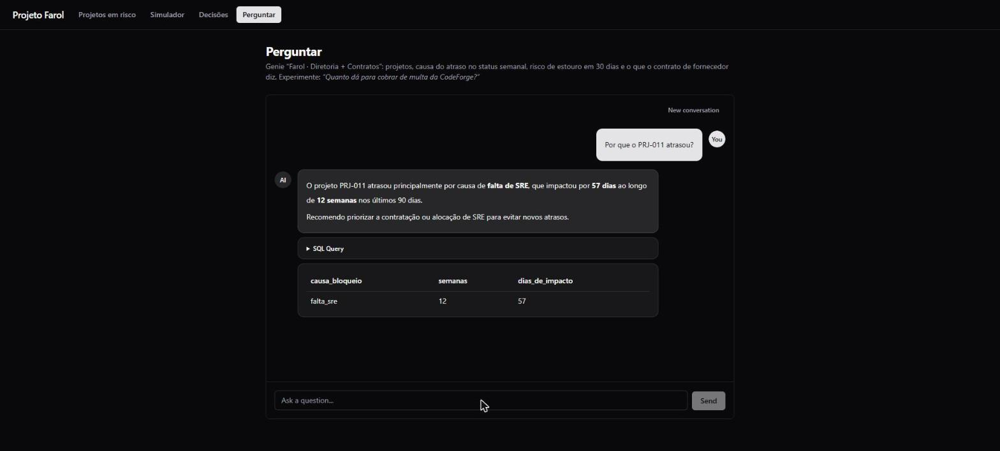
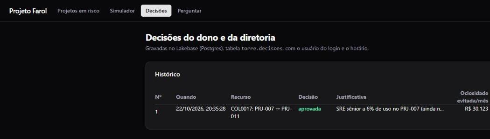

# Projeto Farol · Torre de Controle de Projetos

Construído em 4 noites na **Imersão Databricks + Claude Code** (Jornada de Dados, outubro/2026),
em um workspace **Databricks Free Edition**, com todo o código escrito junto com o **Claude Code**.

> **O problema.** A Vértice Tecnologia (empresa fictícia, 520 pessoas, 60 projetos de clientes) controla os projetos em
> **3 ferramentas que não conversam**: Excel (20), ClickUp (25) e MS Project (15). Ninguém sabia dizer quais projetos
> estavam atrasados, quanto o atraso ia custar, nem que havia gente parada enquanto outro projeto pedia gente.

O dono fez 4 perguntas. O Farol responde as 4, numa URL que ele abre no celular:

| Pergunta do dono | Resposta do Farol |
|---|---|
| Quais projetos estão atrasados, e de quais clientes? | **17 de 41** projetos em risco, 7 críticos, **4 "melancias"** (farol verde do gerente, número vermelho) |
| Quanto esse atraso vai me custar? | **R$ 6,5 mi** de estouro previsto, e **R$ 1,2 mi** de multa que dá para **cobrar** de fornecedor atrasado |
| Tenho gente parada enquanto outro projeto pede gente? | 2 SREs sêniores a 6% de uso no PRJ-007 enquanto o PRJ-011 atrasa por **falta de SRE** |
| O que vai dar errado no próximo mês? | **18 projetos** em alto risco de estourar em 30 dias (modelo de ML), com o motivo em português |



▶️ [Vídeo em 1080p (48 s)](docs/video/projeto-farol-demo.mp4)

---

## O app

Um **Databricks App** (AppKit, React + TypeScript), com o login do próprio workspace, em quatro telas:

| Tela | O que faz |
|---|---|
| **Projetos em risco** | KPIs + todos os projetos do pior para o melhor: SPI, CPI, estouro, atraso, farol do gerente × calculado (🍉), causa do atraso extraída por IA do status semanal e probabilidade de estouro em 30 dias |
| **Simulador** | Pessoa ociosa → projeto em risco: horas recuperadas, ociosidade que deixa de ser paga, dias de cronograma recuperados, custo de onboarding e saldo. A conta fica à vista: o dono não aprova caixa-preta |
| **Decisões** | **Aprovar / Recusar** grava a decisão num **Lakebase (Postgres)**, com o e-mail de quem clicou, o horário e a justificativa |
| **Perguntar** | Um **Genie Agent** que responde em português sobre projetos **e contratos de fornecedor**, citando a cláusula |

**O caso que atravessa o projeto: o PRJ-011.**

1. *"Por que o PRJ-011 atrasou?"* → falta de SRE, em **12 semanas** de status, **57 dias** de impacto.
2. No simulador, a SRE COL0017 (PRJ-007, 6% de uso) → PRJ-011: **151 h** no mês, **R$ 30,1 mil** de ociosidade evitada,
   **19 dias** de cronograma recuperados, saldo de **R$ 22,1 mil** no mês.
3. O dono clica **Aprovar** e a decisão vira uma linha no Postgres.



| Simulador | Perguntar (Genie) |
|---|---|
|  |  |



---

## Arquitetura

```
 Excel (20) ─┐
 ClickUp (25)┼─ bronze ──▶ pipeline Lakeflow (silver: as 3 ferramentas viram uma) ──▶ gold
 MS Project ─┘    │                                                                     │
 status semanal ──┴─ ai_classify + ai_extract: o texto livre do gerente vira coluna ────┤
                                                                                        │
 8 contratos PDF ── ai_parse_document ─▶ cláusulas ─▶ ai_extract (JSON schema) ─▶ gold.contratos
                                                                                        │
 gold.mv_projetos (métricas governadas)  ·  ML: features ─▶ modelo (MLflow + UC) ─▶ gold.score_estouro_30d
                                                                                        │
            ┌──────────────── Genie Agents ◀───────────────────────────────────────────┤
            │                                                                           │
 App "Projeto Farol" (Databricks App) ── leitura: SQL warehouse (gold)                  │
                                      ── escrita: Lakebase Postgres (torre.decisoes)    │
 Dashboard AI/BI ◀──────────────────────────────────────────────────────────────────────┘
```

Tudo é código: um **Databricks Asset Bundle** com o job `vertice_farol`
(conferência da bronze → medalhão → testes → IA nos status → métricas → features → modelo → score),
o dashboard e os Genie Agents versionados no Git.

## O que cada noite construiu

| Noite | Papel | Entregas |
|---|---|---|
| 1 | Analista | Catálogo `lakehouse_vertice`, bronze lendo CSV, Excel, JSON (ClickUp) e XML (MS Project); SPI e CPI em SQL |
| 2 | Engenheiro de dados | Bundle `vertice`: pipeline Lakeflow (silver e gold), 10 testes de qualidade, IA no texto do status, metric view, dashboard AI/BI, Genie "Farol · Diretoria" (benchmark **20/20**) |
| 3 | Cientista de dados | Features projeto × semana (só olhando para trás), modelo de estouro em 30 dias (AUC 0,93, registrado no Unity Catalog com alias `@prod`), score diário com o motivo em português |
| 4 | Engenheiro de IA | Agente que lê contrato (PDF → colunas tipadas), Genie "Farol · Diretoria + Contratos" (benchmark **10/10**), o app e a aprovação no Lakebase |

## Estrutura do repositório

| Pasta | Conteúdo |
|---|---|
| [`setup/`](setup) | Noite 1: catálogo `lakehouse_vertice`, gerador dos dados sintéticos (seed 42) e as 9 tabelas da bronze |
| [`vertice/`](vertice) | Bundle das noites 2 e 3: pipeline, gold, testes, IA, métricas, ML, dashboard, Genie e jobs |
| [`minha-torre/`](minha-torre) | Noite 4: o app (AppKit) e o agente de contratos ([`minha-torre/agente/`](minha-torre/agente)) |
| [`scripts/`](scripts) | `run_sql.py` (roda um `.sql` pela API de statements) e `genie.py` (publica e testa Genie Agents) |
| [`docs/img/`](docs/img) | Prints do app |

## Como reproduzir

Pré-requisitos: workspace Databricks (o Free Edition basta), [Databricks CLI](https://docs.databricks.com/dev-tools/cli/) ≥ 0.250, Node 22+ e Python 3.

```bash
databricks auth login --profile <perfil>

# noite 1: catálogo, dados e bronze
# clone o repositório como Git folder no workspace e rode o notebook setup/00-carregar-dados (Run all)
python scripts/run_sql.py setup/01-ingestao-bronze.sql --profile <perfil>
python scripts/run_sql.py setup/99-verificacao.sql --profile <perfil>

# noites 2 e 3: pipeline, métricas, ML, dashboard e Genie
cd vertice
databricks bundle deploy --profile <perfil> --var="warehouse_id=<id do seu warehouse>"
databricks bundle run vertice_farol --profile <perfil> --var="warehouse_id=<id do seu warehouse>"

# noite 4: contratos, Genie de contratos, Lakebase e app
cd ../minha-torre
python ../scripts/run_sql.py agente/01-contratos.sql --profile <perfil>
python agente/gerar_genie.py --profile <perfil>
python ../scripts/genie.py publicar agente/diretoria-contratos-genie.json --titulo "Farol · Diretoria + Contratos" --profile <perfil>
databricks postgres create-project minha-torre --profile <perfil>
databricks bundle deploy --profile <perfil>            # cria o app e o service principal (o 1º build falha sem GRANT)
bash scripts/conceder-acesso.sh <perfil>               # GRANT na gold e na silver para o service principal
databricks apps deploy --profile <perfil>
```

O host do workspace vem do `--profile`. Em `minha-torre/databricks.yml`, troque o id do SQL warehouse,
o id do Genie e o branch do Lakebase pelos seus, e copie `minha-torre/.env.example` para `minha-torre/.env`.

## Armadilhas que valeram aprendizado

- **Número vem como string do SQL warehouse.** `Number()` antes de qualquer conta ou formato, senão `+` concatena.
- **O app é um usuário.** Ele roda como service principal e nasce sem acesso a nada: sem `GRANT`, o build quebra.
- **`ai_extract` sem schema devolve texto** (`"0,5% ao dia"`); **com JSON schema tipado** devolve `0.5`, dado que dá para somar.
- **Arredonde só na saída.** Calcular o EAC sobre o CPI já arredondado em 4 casas desviava o estouro da carteira em R$ 127.
- **Delta para analisar, Postgres para gravar um clique.** A decisão do dono vai para o Lakebase, não para uma tabela Delta.

---

Feito por Gabriel Cecci Tardioli na Imersão Databricks + Claude Code da Jornada de Dados.
O caso, o gerador de dados (`setup/`) e os scripts de apoio (`scripts/`) vêm do material da imersão:
[lvgalvao/ImersaoControlTower](https://github.com/lvgalvao/ImersaoControlTower).
Os dados são sintéticos (seed 42): nenhuma empresa ou pessoa real.
